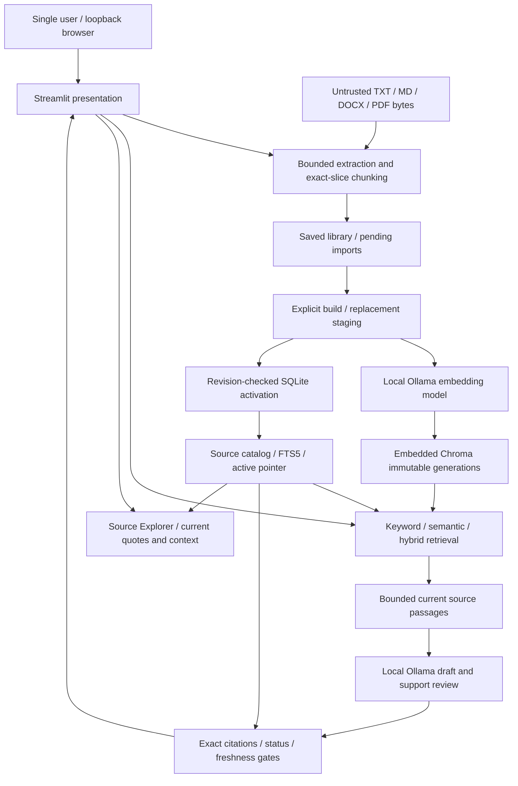

# Architecture

Streamlit (`app.py`) owns presentation and session state. `src/knowledgebridge` owns strict Pydantic models, configuration, byte-based extraction, chunking, embedding requests, persistence, reindexing and retrieval. It never imports Streamlit.

Flow: bounded upload bytes → parser → exact source sections/passages → persistent library collection → explicit index build → local Ollama vectors → staged Chroma generation → atomic SQLite source/FTS/active-pointer transaction → keyword/semantic/hybrid passage retrieval.

## System diagram

Ollama is a separate process reached only through the configured literal loopback endpoint. Chroma is embedded, with explicit vectors and no Chroma HTTP server. SQLite activation is atomic; the two stores do not share a distributed transaction. Validation can withhold failures but cannot prove semantic support. The evaluator's Python offline guard is scoped separately from OS or Ollama network controls.

## Components

- `models.py`, `parsers.py`, `chunker.py`, `ingestion.py`: validated source identities, extraction, bounded exact windows and atomic import.
- `config.py`: bounded safe YAML and loopback-only retrieval settings.
- `embedding_adapter.py`: typed embedding protocol, bounded HTTP responses, batching, no truncation, local-model verification, vector validation and normalization.
- `retrieval_models.py`: embedding identity, index manifest and source-linked search records.
- `index_repository.py`: SQLite catalog, isolated FTS5 indexes and Chroma persistence. No default Chroma embedding function is enabled.
- `retriever.py`: query limits, model compatibility checks, retrieval and deterministic reciprocal rank fusion.
- `indexing.py`: selected-document rechunking followed by a complete atomic collection rebuild.

Each build creates a random internal Chroma generation. After embeddings and IDs are validated, one SQLite transaction saves the source collection, a source fingerprint, manifest, passage records, a dedicated FTS5 table and the active generation pointer. Failures before activation leave the previous snapshot active. SQLite activation is atomic; Chroma and SQLite are not a distributed transaction. A crash can leave an orphan Chroma generation, which is never activated implicitly.

Readers use immutable generations and check freshness before returning. Library revisions are compared again at activation, so stale builds cannot overwrite concurrent updates. Retired generations are removed after lifecycle changes; an in-flight old reader must retry after its generation is superseded. Each FTS5 table has its own corpus statistics, avoiding ranking changes from unrelated collections/generations.

The manifest records model name, digest, dimensions, adapter version, truncation policy, source fingerprint, generation and build time. Source records retain chunking fingerprints, hashes, versions, section/page locations and exact slices. Model changes block semantic/hybrid search until rebuilding; keyword search remains available. Catalog/source/FTS mismatches and missing vector IDs fail with actionable generic diagnostics. These integrity checks detect structural inconsistency, not all possible same-shape numerical corruption or deliberate local tampering.

Original uploads are not saved. Parsed source sections and metadata are retained as the rebuild basis. Reindexing a selected document uses current chunk limits and rebuilds all collection embeddings to preserve an atomic snapshot. Milestone 4 adds atomic replacement, model-independent deletion, collection lifecycle and obsolete-generation cleanup.

## Upstream references

- [Ollama embedding API](https://docs.ollama.com/api/embed): explicit arrays, truncation and response vectors.
- [Chroma Python client](https://docs.trychroma.com/reference/python): persistent collections and explicit embeddings.
- [Chroma client telemetry setting](https://docs.trychroma.com/updates/migration): `anonymized_telemetry=False`.
- [SQLite FTS5](https://www.sqlite.org/fts5.html): tokenization, MATCH and BM25 semantics.

## Milestone 3 answer path

`answer_models.py` defines bounded draft claims, exact-quote evidence, conflicts, support reviews, generation identity and application-owned answer statuses. `answer_generator.py` uses a generation protocol and the shared loopback `OllamaTransport`; no embedding or generation tools are offered to the model. `citations.py` resolves references only to supplied passages in the current active snapshot. `answering.py` bounds whole source passages, drafts structured answers, validates citations, requests a separate support/completeness/conflict review and revalidates freshness before returning substantive text. The Streamlit Ask KnowledgeBridge view renders inert output and source quotes, with no persisted chat history. See milestone_3_design.md for the complete policy and limits.

## Milestone 4 library lifecycle

Schema 2 adds a durable library source catalog with monotonic revisions, a staging/active/retired generation registry, and content-free deleted-collection tombstones. Schema 1 active snapshots are copied additively into the library; active manifests and source IDs remain unchanged. The library can hold empty or pending-source collections independently from the active index.

`library.py` manages replacement, deletion, index health and strict active source resolution. Replacement parses a candidate independently and publishes sources, metadata, FTS and the active generation only after successful vector creation. Deletion streams batches of retained embeddings into a new generation without a model; removing the last active source deactivates the index. Pending imports are preserved. Collection deletion atomically removes library/active pointers and prevents stale-session restoration through a tombstone.

Activation compares the captured revision and active generation, then marks the old generation retired. A registry entry is written before staging vectors; cleanup skips active and staging generations, including builds in progress. Cleanup removes retired/legacy-orphan Chroma collections, FTS tables and passage rows. It is post-commit and retryable, so cleanup failure cannot make deleted sources active again. Chroma and SQLite still do not share a distributed transaction; interrupted staging can leave protected data that requires operator recovery, and logical deletion is not secure erasure.

Streamlit reloads durable library sources each rerun, passes the revision previously displayed for mutations, and binds destructive confirmations to source/revision identity. A transient latest-answer record supports navigation to Source Explorer; stale answers and references are withheld after generation changes. There is no disk answer history.
